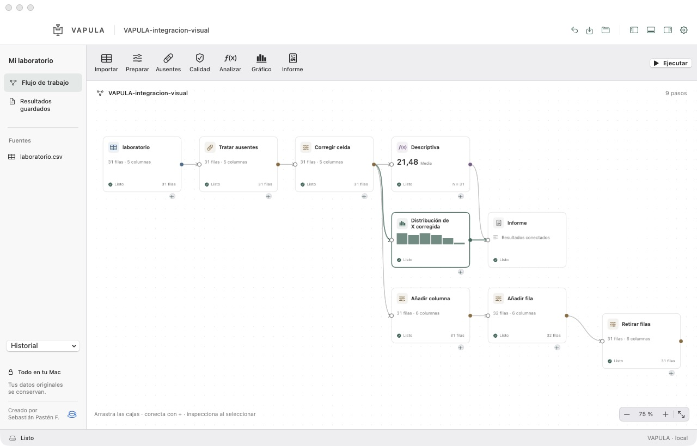
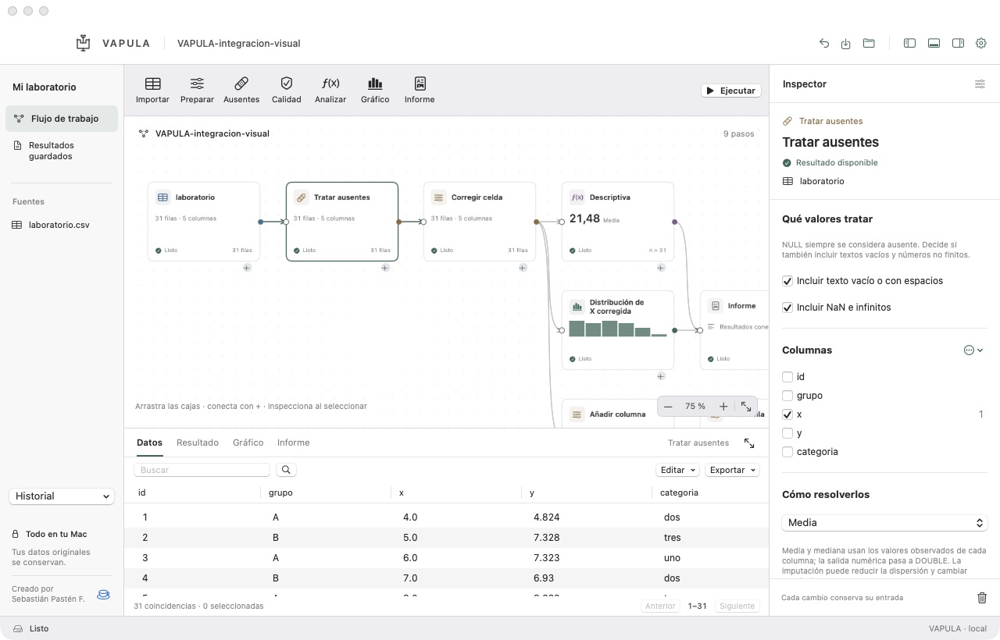
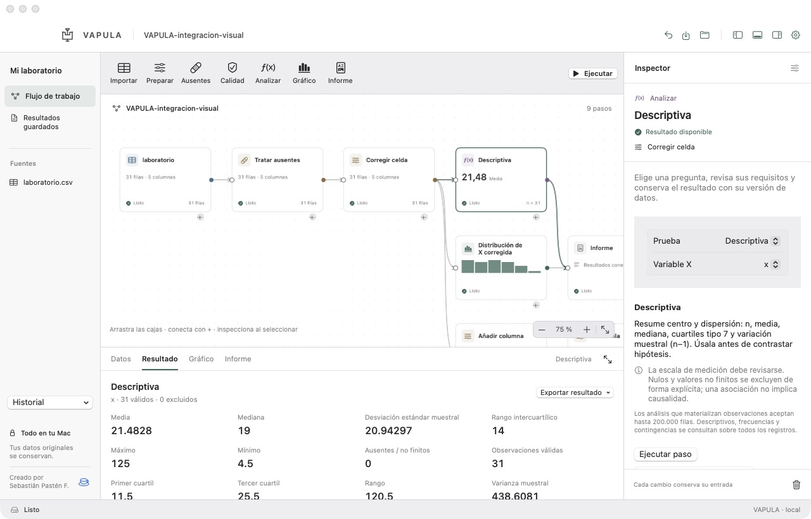
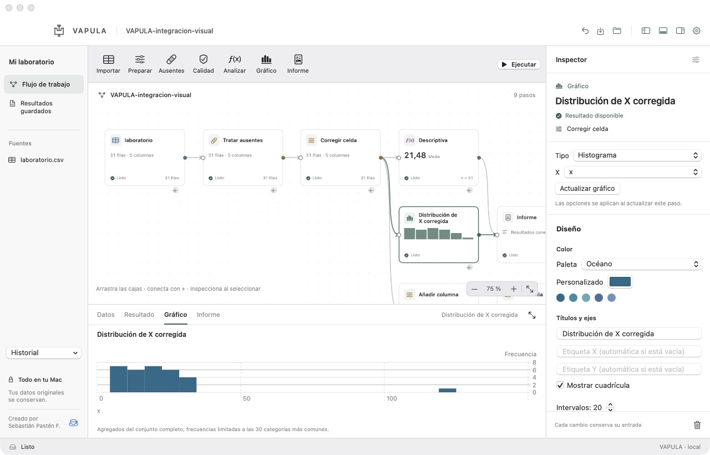

<div align="center">
  
  <h1>VAPULA</h1>
  <p><strong>De los datos a la evidencia.</strong></p>
  <p>Prepara datos, conecta análisis y comparte resultados en tu Mac.</p>
  <p>
    
    
    
  </p>
  <p><a href="https://github.com/AD0441/VAPULA/releases/tag/v0.1.1">Descargar 0.1.1</a> · <a href="#qué-nos-diferencia">Ventajas</a> · <a href="#en-uso">En uso</a> · <a href="#empezar">Empezar</a> · <a href="docs/LIMITATIONS.md">Alcance</a> · <a href="docs/REQUIREMENTS.md">Requisitos</a> · <a href="docs/STATUS.md">Pendientes</a> · <a href="https://ko-fi.com/C0C51WQ1T0">Apoyar</a></p>
</div>


**VAPULA** reúne preparación, calidad de datos y estadística en un escritorio de cajas conectadas. Importa una tabla, revisa los valores ausentes, corrige lo necesario y conecta análisis, gráficos e informes. Cada transformación crea una versión nueva; las fuentes originales se conservan.

**Creado por Sebastián Pastén F.** Forma parte de la misma familia de herramientas para Mac que [METATRON](https://github.com/AD0441/METATRON), [PAIMON](https://github.com/AD0441/PAIMON) y [RAZIEL](https://github.com/AD0441/RAZIEL). Su motor usa [DuckDB Swift oficial](https://github.com/duckdb/duckdb-swift); la interfaz, el flujo y la identidad son propios.

**Versión preliminar: [VAPULA 0.1.1, para Apple Silicon](https://github.com/AD0441/VAPULA/releases/tag/v0.1.1).** Incluye diez métodos estadísticos, ocho formas de gráfico y exportación PDF/Markdown con figuras. La validación local comprende **69 pruebas optimizadas** y un recorrido real de la aplicación con datos sintéticos. Consulta [validación y cobertura](docs/VALIDATION.md), [límites efectivos](docs/LIMITATIONS.md) e [historial de cambios](CHANGELOG.md).

**Nuevo en 0.1.1:** recuperación de sesiones interrumpidas, reserva de escritura, conversiones con impacto y aceptación, borradores del inspector y exportación con alcance explícito. [Qué cambió y cómo se verificó](docs/INTEGRITY-STAGE.md).

La [lista de requisitos](docs/REQUIREMENTS.md) recoge lo acordado, las mejoras y la aceptación esperada. La [matriz de estado y pendientes](docs/STATUS.md) distingue lo implementado, lo parcial y las ampliaciones propuestas; la versión preliminar no cierra todos los requisitos indispensables.

## Simplicidad con impacto

**Concéntrate en lo que vale la pena.** Creamos herramientas nativas para Mac que reúnen lo necesario en un flujo claro: menos pasos repetidos, decisiones visibles y control sobre tu trabajo. En VAPULA, eso significa seguir una pregunta desde la tabla original hasta un resultado con procedencia.

Compartimos una filosofía y una [identidad visual](docs/FAMILY.md); cada aplicación conserva su propósito, su sello y sus límites.

## Qué nos diferencia

| Lo que necesitas | Nuestra ventaja práctica | Alcance que debes conocer |
| --- | --- | --- |
| Corregir conservando el punto de partida | Cada transformación produce una versión nueva; puedes abrir otra rama desde la entrada. | Las versiones ocupan espacio en disco. |
| Analizar sin preparar un entorno de programación | Motor integrado, siete familias de herramientas, diez métodos y ocho gráficos. | El catálogo se concentra en estadística general y datos locales. |
| Compartir algo más que un número | Informes con versión de datos, variables, parámetros, exclusiones y advertencias. | Los supuestos y los efectos de la imputación siguen requiriendo revisión. |

Frente a una planilla con ediciones directas, VAPULA pone las versiones y sus análisis en el mismo flujo. Frente a **KNIME** o **pandas**, ofrece un recorrido acotado con controles nativos, sin instalar Python ni R para usar la app. Sus ecosistemas son más amplios; **Power Query** también registra pasos y **pandas** también trata ausentes. [Comparativa con fuentes oficiales y límites](docs/COMPARISON.md).

## En uso

Estas capturas pertenecen a la aplicación real, utilizan exclusivamente datos sintéticos y se conservan sin modificar.



| Preparar y tratar ausentes | Analizar y revisar resultados |
| --- | --- |
|  |  |



## Qué puedes hacer

- **Importar** CSV, TSV y Parquet con vista previa y opciones de lectura. Buscar, ordenar y consultar perfiles completos desde una tabla nativa paginada.
- **Preparar** datos: filtrar, elegir o renombrar columnas, convertir tipos, derivar valores, ordenar y agregar por grupos.
- **Tratar ausentes**: revisar el impacto y elegir media, mediana, moda, un valor indicado o retirar filas/columnas afectadas. NULL siempre cuenta como ausente; tú decides si incluir texto vacío, NaN e infinitos.
- **Corregir de forma explícita**: editar una celda con doble clic, añadir filas y columnas o retirar filas seleccionadas. La nueva versión conserva su relación con la entrada.
- **Revisar calidad**: encontrar candidatos por ausentes, no finitos, claves duplicadas, rangos e IQR, con evidencia por hallazgo.
- **Analizar y visualizar**: ejecutar pruebas generales, personalizar gráficos y reunir las salidas en un informe PDF, Markdown con imágenes locales o CSV.

Consulta la [matriz de alcance y límites](docs/LIMITATIONS.md). Una detección de calidad no confirma un error; la imputación puede cambiar la dispersión y las asociaciones, y los análisis posteriores lo advierten.

## Un flujo, siete familias de herramientas

La barra añade cajas al escritorio. El inspector configura el paso seleccionado y el panel inferior muestra **Datos, Resultado, Gráfico o Informe**.

| Herramienta | Para qué sirve |
| --- | --- |
| **Importar** | Incorporar una fuente local al proyecto. |
| **Preparar** | Transformar datos y crear una versión reproducible. |
| **Ausentes** | Contar y resolver valores faltantes con una política explícita. |
| **Calidad** | Aplicar reglas y revisar evidencia. |
| **Analizar** | Elegir el método y sus variables; conservar parámetros y resultado. |
| **Gráfico** | Explorar una versión con forma, color y ejes configurables. |
| **Informe** | Reunir análisis, gráficos y controles de calidad para exportar. |

Continúa una rama con **+**, conecta puertos compatibles, mueve las cajas y ejecuta un paso con sus entradas o los pasos pendientes del flujo. Si cambias una entrada, sus descendientes quedan por actualizar. Puedes retirar una rama y deshacer ese cambio; las versiones y los resultados ya guardados permanecen en el historial.

Los proyectos `.vapula` contienen datos y metadatos. Guarda el flujo con **⌘S**, ejecuta con **⌘R** y ajusta el lienzo con **⌘0**. Cierra el proyecto antes de mover o copiar su paquete. Al reabrir, ejecuta el gráfico para regenerar su vista previa con los parámetros guardados.

## Ventajas para el trabajo diario

VAPULA conecta la limpieza, el análisis y la presentación de resultados en el mismo laboratorio. Está pensado para responder preguntas generales sobre datos locales, con un catálogo pequeño y decisiones visibles.


**Cada corrección deja una versión recuperable.** Editar una celda, añadir una fila o rellenar ausentes crea una salida nueva. Puedes volver a la entrada y abrir otra rama sin organizar copias manuales del archivo.

**Menos montaje para una pregunta estadística general.** El bundle reúne motor de datos, diez métodos y ocho gráficos en controles nativos. El usuario final no necesita instalar Python, R ni extensiones para recorrer ese flujo.

**El resultado lleva su procedencia.** Versión de datos, variables, parámetros, válidos, excluidos y advertencias acompañan el análisis y su informe. La limpieza no queda separada de los números que después compartes.

| Si hoy trabajas con… | Dónde ayuda VAPULA | Cuándo elegir la otra opción |
| --- | --- | --- |
| **Una planilla con ediciones directas** | Mantener versiones explícitas de las correcciones y sus análisis conectados. | Trabajos centrados en fórmulas y organización dentro del libro. |
| **KNIME** | Empezar con siete familias de herramientas enfocadas en datos locales y estadística general para Mac. | Flujos que necesiten su ecosistema más amplio de integraciones. |
| **Python con pandas** | Preparar, analizar y exportar desde formularios y cajas, sin escribir un programa para esa tarea. | Transformaciones personalizadas y automatización mediante código. |

[Comparativa detallada, ejemplo reproducible, fuentes y límites](docs/COMPARISON.md). Power Query también conserva pasos y pandas también trata ausentes; el aporte de VAPULA está en reunir las tareas y sus versiones en este espacio de trabajo. La imagen del portátil es una composición promocional, distinta de las capturas reales de arriba.

## Métodos estadísticos

| Pregunta | Métodos disponibles |
| --- | --- |
| **Describir** | Media, mediana, cuartiles tipo 7, dispersión muestral y recuentos. |
| **Comparar medias** | t de una muestra, t pareada, t de Welch y ANOVA de un factor. |
| **Explorar asociaciones** | Pearson, Spearman y chi-cuadrado de independencia. |
| **Comparar distribuciones** | U de Mann–Whitney con aproximación asintótica. |
| **Modelar** | Regresión lineal con un predictor. |

Cada resultado conserva versión de datos, variables, procedimiento, observaciones válidas/excluidas y advertencias. Los contrastes que lo admiten incluyen p bilateral e intervalos. Pearson/Spearman informan coeficiente y n, sin p-valores. No se incluyen pruebas post-hoc, corrección por comparaciones múltiples ni regresión múltiple.

Los resultados se comparan con **1.356 valores de referencia independientes** generados durante el desarrollo con SciPy. [Métodos, tolerancias y supuestos](docs/STATISTICAL-VALIDATION.md). Una asociación no establece causalidad; los intervalos y p-valores posteriores a imputar no incorporan su incertidumbre.

## Gráficos e informes

**Histograma, barras verticales, barras horizontales, dispersión, línea, área, boxplot y puntos con tallos.** Elige entre seis opciones de paleta, incluido color personalizado HEX, y ajusta títulos, ejes, rejilla, formas, tamaño de puntos y grosor. Las opciones se guardan con el paso del flujo. [Guía de gráficos](docs/CHARTS.md).

Los informes PDF tienen texto vectorial paginado y figuras PNG; los Markdown incluyen imágenes junto al documento. Conserva esos archivos al compartir el Markdown. Las exportaciones de datos ofrecen CSV y Parquet. Los destinos existentes se protegen: elige un nombre nuevo. [Exportación y procedencia](docs/PDF-EXPORT.md).

El perfil y los gráficos agregados utilizan todo el conjunto. Dispersión, líneas y áreas muestran hasta los primeros 2.000 pares finitos; las frecuencias, las 30 categorías más comunes. Las operaciones estadísticas que materializan observaciones rechazan más de 200.000 filas. Se admiten hasta 256 columnas y 500 cajas por flujo. Los límites no representan muestreo aleatorio ni una garantía de rendimiento universal.

## Empezar

[Descargar VAPULA 0.1.1 para Apple Silicon](https://github.com/AD0441/VAPULA/releases/tag/v0.1.1) · [Código fuente](https://github.com/AD0441/VAPULA)

1. Descarga el ZIP de la versión preliminar, descomprímelo y abre `VAPULA.app`.
2. Crea un proyecto `.vapula` e importa tu CSV, TSV o Parquet.
3. Añade pasos, configura sus opciones en el inspector y revisa las salidas antes de exportar.

Para empezar con datos de demostración, descarga [laboratorio.csv](Tests/VapulaTests/Fixtures/laboratorio.csv): contiene 31 filas sintéticas, ausentes, duplicados y un valor extremo.

**Requisitos:** Apple Silicon y macOS 14 como mínimo de compilación. La ejecución y revisión local se realizaron en un MacBook Pro M1 de 8 GB con macOS 27.2; la compatibilidad con otros macOS todavía necesita validación en esos equipos. Firma **ad hoc**, sin Developer ID ni notarización. Si macOS impide abrir la descarga, consulta [la guía de apertura de Apple](https://support.apple.com/es-cl/102445); no desactives Gatekeeper globalmente. El ZIP incluye su archivo SHA-256.

El usuario final no necesita Python, R, Homebrew ni Xcode para ejecutar el bundle. Usa la aplicación actualizada con proyectos que incorporen las nuevas operaciones; las compilaciones antiguas no pueden leer esos pasos.

### Compilar desde el código

Requiere Xcode con Swift 6.2 o posterior. La primera compilación obtiene la dependencia oficial fijada de DuckDB.

```sh
git clone https://github.com/AD0441/VAPULA.git
cd VAPULA
VAPULA_BUILD_CONFIGURATION=release ./script/build_and_run.sh
```

```sh
./script/test.sh -c release
./script/build_and_run.sh --verify
VAPULA_BENCHMARK=1 ./script/test.sh -c release --filter PerformanceTests
```

El script genera `dist/VAPULA.app`. El proyecto usa SwiftPM y selecciona Xcode mediante `DEVELOPER_DIR`, sin cambiar la configuración global. [Arquitectura](docs/ARCHITECTURE.md) · [Formato del proyecto](docs/DATA-MODEL.md) · [Validación](docs/VALIDATION.md).

## Procesamiento local y Apple Silicon

Sin cuentas, telemetría, IA online, consola SQL ni comprobaciones automáticas de actualización. DuckDB se incluye en el ejecutable y sus extensiones automáticas y sistemas de archivos remotos están deshabilitados. Ko-fi sólo abre el navegador cuando eliges visitar el enlace. [Privacidad y alcance de la verificación](docs/PRIVACY.md).

La interfaz limita las filas y puntos visibles; el actor de datos ejecuta las consultas fuera de la interfaz. El objetivo es trabajar bien en un M1 de 8 GB, midiendo antes de introducir aceleración. Las mediciones disponibles y su carga de prueba están en [rendimiento](docs/PERFORMANCE.md); no se extrapolan a otros equipos ni a cualquier conjunto de datos.

## Contribuir

Son bienvenidos los [errores y propuestas](https://github.com/AD0441/VAPULA/issues), ejemplos sintéticos reproducibles, pruebas de métodos, accesibilidad y traducciones. Consulta [CONTRIBUTING.md](CONTRIBUTING.md) y [CODE_OF_CONDUCT.md](CODE_OF_CONDUCT.md). No adjuntes datos personales ni credenciales.

Para priorizar trabajo, consulta los [requisitos del producto](docs/REQUIREMENTS.md) y su [cobertura con evidencia](docs/STATUS.md). Las ampliaciones propuestas requieren concretar su alcance antes de implementarse.

Las nuevas funciones deben mantener el procesamiento local, la procedencia de los resultados, el cuidado de los originales y límites claros de memoria y visualización.

## Apoyar el proyecto

Los aportes voluntarios ayudan a mantener el desarrollo, la documentación y las pruebas de VAPULA.

[](https://ko-fi.com/C0C51WQ1T0)

## Identidad y licencia

El sello de Vapula tiene una interpretación geométrica original, con SVG, PNG, ICNS y [generador reproducible](script/make_brand.swift). La portada actual adopta la [identidad común de la familia](docs/FAMILY.md) con el sello propio de VAPULA. La imagen promocional del portátil se conserva en el apartado de ventajas; [procedencia de esas imágenes](docs/assets/promo/README.md). El modelo de trabajo toma ideas de editores de flujo como KNIME, sin reutilizar su código ni sus recursos. [Identidad](docs/BRAND.md) · [Referencia de KNIME](docs/KNIME-REFERENCE.md).

Licencia **MIT**. Se incluyen los avisos de [DuckDB y sus componentes](THIRD_PARTY_NOTICES.md). No existe afiliación con Apple, KNIME o los proyectos citados.

<div align="center">
  <p><strong>Simplicidad con impacto.</strong><br>Concéntrate en lo que vale la pena.</p>
  <p><a href="https://github.com/AD0441/NABERIUS">NABERIUS</a> · <a href="https://github.com/AD0441/RAZIEL">RAZIEL</a> · <a href="https://github.com/AD0441/METATRON">METATRON</a> · <a href="https://github.com/AD0441/PAIMON">PAIMON</a> · <a href="https://github.com/AD0441/VAPULA">VAPULA</a></p>
  <p><strong>Creado por Sebastián Pastén F.</strong></p>
  <p><a href="https://www.sebastianpasten.com/desarrollos-aplicaciones-para-mac-software-sdr">Más aplicaciones para Mac</a> · <a href="https://ko-fi.com/C0C51WQ1T0">Apoyar en Ko-fi</a></p>
</div>
