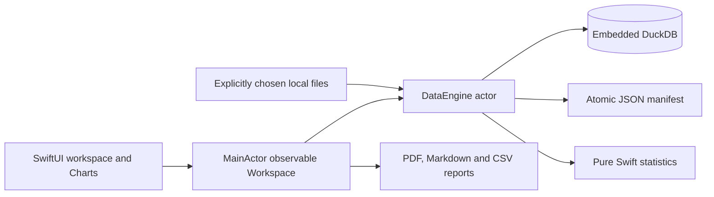

# Architecture / decisions

VAPULA is a native modular monolith for macOS 14+ arm64. SwiftPM is the reproducible project generator/manifest; Xcode's complete platform SDK is selected by the scripts when available. No system Python, R, DuckDB installation or Homebrew is used at runtime.

- **VapulaCore**: Codable/Sendable values, typed operations, SQL escaping and ProjectRepository contract. A JSON repository keeps metadata separate from tabular storage. It avoids a second relational database for a small, human-inspectable manifest.
- **VapulaData**: a single actor owns each database/connection and serializes complete operations. SQL is generated from closed enums; filter/search values are prepared parameters, file paths and identifiers are escaped. No SQL console. Physical tables only; manifest references cannot point at views.
- **VapulaStatistics**: one-sample/paired t, classical one-way ANOVA, asymptotic tie-corrected Mann–Whitney, Pearson chi-square, finite-value validation, Welford descriptive moments, centered covariance Pearson/one-predictor OLS, average-rank Spearman, Welch with a converged continued-fraction incomplete beta and bisection t quantiles. OLS uses no inverse of X'X. Accelerate is unnecessary for a scalar one-predictor fit; a future multi-predictor implementation must select QR/LAPACK.
- **VapulaReports**: source hashes, data-version IDs, full transformation history, result parameters and warnings. Exclusive creation protects existing files.
- **VapulaApp**: scene-owned observable workspace on MainActor; one task per operation, explicit cancellation. Native dynamic NSTableView is wrapped narrowly because schemas have a variable number of columns. Swift Charts receives aggregates or bounded points. Settings are a separate native scene.

No generic service hierarchy, extension system, event bus or background scheduler. All data work runs on DataEngine, not the UI actor. Cancellation is cooperative before/after synchronous DuckDB calls, and before commit; an in-progress query must finish before cancellation is honored. This limitation is visible in the app and documented.

## Query ownership and optimized builds

The engine is the official pinned DuckDB package, linked statically. `VapulaData/OwnedQuery.swift` uses its public `Cduckdb` API for a small actor-confined ownership bridge. An optimized test run exposed a SIGSEGV in the upstream Swift result-vector access path; merely extending Swift result lifetime did not resolve it. The bridge owns each C result until destruction and copies scalar cell values before the result can be destroyed. No borrowed vector escapes the DataEngine actor. The complete optimized suite, including reopen/import/profiles/transformations/statistics, passes with this bridge. This records the observed local failure and remedy; it is not a claim that all upstream clients crash.

## Workflow, charts and reporting

The original provenance projection is now the migration source for a persistent executable DAG of built-in typed operations. Dataset parent IDs and result dataset IDs remain the immutable historical record. Chart configurations are optional manifest values keyed by dataset UUID, preserving schema-1 compatibility when the field is absent. Pending input controls cannot relabel cached chart data; executed variable names and bin counts are tracked separately. The PDF exporter uses CoreGraphics/CoreText pagination and PDFKit only in tests; no web view is needed.

## Integrated workbench (2026-10-31)

`VapulaCore.DataWorkflow` persists a versioned typed DAG in optional schema-1 metadata. Old manifests infer a graph from dataset ancestry and saved analyses without rewriting tables. Data/prepare/missing provide datasets; analysis, quality and chart consume datasets; reports combine outputs. Graph validation rejects cycles, incompatible ports, foreign IDs and malformed coordinates. `VapulaData.executeWorkflow` runs a topological ancestor order, skips clean operations, invalidates descendants after changed outputs and persists each successful step. A failed step stores its error; completed versions remain recoverable. Charts use bounded display artifacts and exact aggregates rather than storing raw chart points in JSON.

The SwiftUI workbench owns selection, canvas positions and draft inspectors; the database actor owns materialization and physical row identities. A narrow NSTableView bridge exposes cell double clicks and row selection. Typed missing-value and manual-edit transformations pass through the same immutable transaction/atomic metadata path. Manual edit forms and operation inspectors only commit with their explicit apply/run button. Canvas changes save automatically; pending positions save before project switch/close/application quit.
