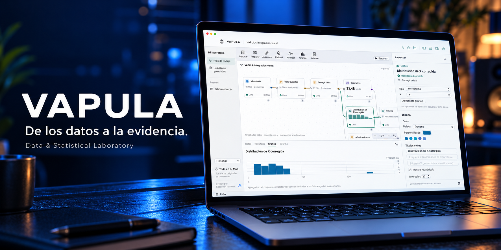

# VAPULA: de una tabla a un resultado que puedes explicar

Hay una diferencia entre obtener un número y poder explicar cómo llegaste a él. VAPULA reúne preparación de datos, estadística y gráficos en un escritorio de cajas conectadas para tu Mac. Cada paso deja visible la versión que utilizaste y el resultado que produjo.

## Corregir con una entrada que puedes recuperar

Puedes editar una celda, añadir filas o columnas y retirar las filas seleccionadas. Cada operación crea una versión nueva; la entrada se conserva. Si decides probar otro criterio, puedes volver a ella y continuar otra rama del flujo.

Para los datos ausentes, revisas primero cuántas celdas y filas se verán afectadas. Después eliges media, mediana, moda, un valor indicado o retirar filas/columnas afectadas. Las advertencias acompañan los análisis posteriores para recordar que imputar puede cambiar la dispersión y las asociaciones.

## Menos montaje para preguntas generales

Diez métodos estadísticos y ocho formas de gráfico comparten las mismas versiones de datos. El motor viene incluido en la aplicación; el usuario final puede trabajar sin instalar Python, R ni extensiones. El catálogo acotado ayuda a encontrar las operaciones habituales desde siete familias de herramientas.

VAPULA encaja especialmente bien cuando necesitas preparar una tabla local, analizarla y compartirla en un informe sin repartir cada fase entre aplicaciones. Una planilla sigue siendo útil para el trabajo centrado en fórmulas; KNIME ofrece un ecosistema más amplio; Python permite programar transformaciones a medida. La [comparativa detallada](../COMPARISON.md) explica esas diferencias y sus fuentes.

## Compartir la evidencia

Conecta tus análisis y gráficos a una caja de informe y exporta a PDF o Markdown con imágenes. Los resultados conservan versión de datos, variables, procedimiento, observaciones válidas y excluidas, y advertencias. El procesamiento habitual es local y las fuentes originales se conservan.

**VAPULA · De los datos a la evidencia.**

[Conocer y descargar](https://github.com/AD0441/VAPULA/releases/tag/v0.1.0) · [Alcance y límites](../LIMITATIONS.md)

La ilustración del portátil es una composición promocional generada a partir de una captura real. La página de GitHub incluye también las capturas de uso sin modificar.
